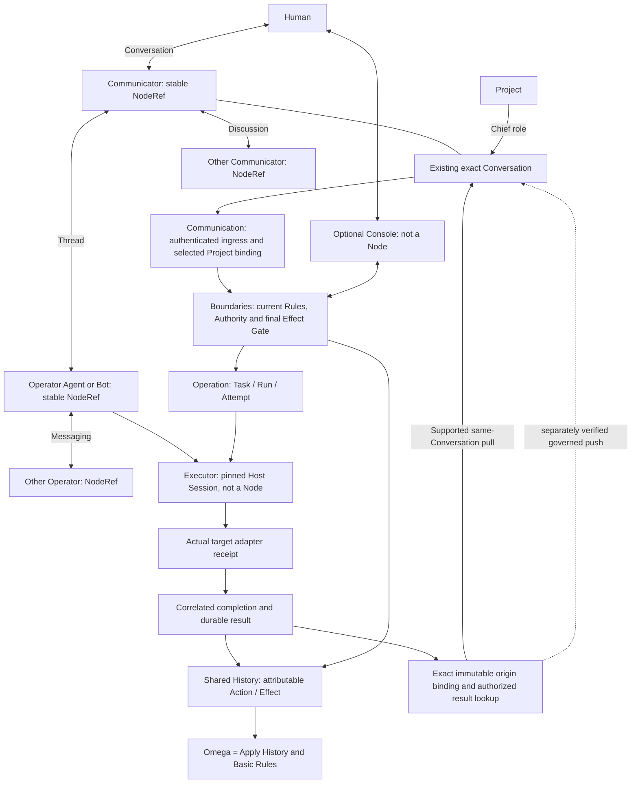

# Sidera R1 · Architecture

## 2026-10-11 additive correction: headless Chat-first precedence

This section takes precedence over contradictory historical implementation and
desktop descriptions below. It implements the owner's
`../../SIDERA_CHATFIRST_R0_20261011.md` directive (located in the convergence root,
two directories above this checkout). It does not amend Basic Rules or certify a
release. The signed [Constitution](SIDERA_R1_CONSTITUTION.md), accepted
[Vision](VISION.md), and preserved [Human source prompt](Sidera_R1_Astra_OneShot_Refactor_Prompt.md)
anchor the ontology. The Constitution's later versioned parent-policy procedure
qualifies the prompt's original bootstrap review topology. The backend working
plan and migration map remain subordinate to those constitutional boundaries.

Sidera is independent multi-Agent middleware, usable without a desktop window.
Ordinary Human text stays in the existing Chief ChatGPT Conversation (or another
supported authorized Communicator). The optional Console is the Human interface
to Boundaries. P1–P5 desktop Conversation, Work and native first-use components
remain reusable local clients; their UI acceptance and native Host receipts do
not establish current ChatGPT connector ingress or exact-origin return. Desktop
startup, a new local Chief, a composer and native first-use enrollment are not
prerequisites for Chat-first P0. Historical G3 charters and their scoped evidence
are retained; instructions such as "Implement P1 first" no longer set global
priority. Human-only login, Grant adoption and connector approval remain Human acts.



These are responsibilities in the existing Core and adapters, not new services.
Chief is `Project → Conversation role → Communicator NodeRef`. NodeRef is neither
model, Host, account, Session nor window. Executors and Conversations share their
owning Node's private D/E and have no independent subjecthood. CESAR dimensions
remain independent. D/E is canonical in the per-Node local CAS region specified
by the Constitution; the older paragraph below calling SQLite `node_subjectivity`
the current store is superseded. Shared History remains the single public source;
Task/Run/index rows and diagnostic reports do not form a second truth store.

The older UI-egress/composer-readiness paragraph below is also superseded. No
browser automation or synthetic Presence may repair missing provider capability.
The normal route is an authenticated tool request from the existing Chat, a
selected Project/Chief binding, authorized Task dispatch to an exact Operator
Executor, an actual adapter receipt, completion and durable result, then a
supported tool fetch in the originating Chat. Pull is sufficient when supported;
it does not imply unsolicited push, autonomous Chat wake or Human observation.

### Evidence and origin contract

| State | Required evidence; cannot be inferred from the previous row |
| --- | --- |
| Registered transport | Configured edge/adapter identity; no availability claim |
| Authenticated ingress | Actual validated request bound to Node principal; not proof of exact Chat |
| Selected Chief Project | Exact Project + binding + Conversation + Communicator NodeRef; caller scope checked |
| Authorized dispatch | Current Human-rooted Authority, resource/budget and final Effect Gate; request ID fixed |
| Target receipt | Exact pinned Session/Executor, message ID and adapter Host receipt; not completion |
| Durable outcome | Correlated Task/Run/Attempt/recognized Effect and result in History/materialized indexes |
| Origin retrieval | Result belongs to immutable originating binding and is read by its authorized context |
| Chat/Human observation | Separate provider/tool observation evidence; a Core read alone proves neither |

The proposed origin tuple is `{communicatorNodeRef, conversationRef, projectRef,
bindingId, originSessionId, requestId}` with authenticated edge/context provenance.
These are required correlations in existing records/interfaces, not a new database.
Current role holder and immutable task origin are distinct. Human handoff may
authorize a separately recorded transfer; it must not silently redefine "returned
to originating Chat". A caller-supplied URL alone cannot attest provider Chat
identity. Ambiguous Project selection must fail before Task creation; an explicit
selection must work even when the same Communicator holds another Project's role.

`BLOCKED` creates no Task/Run/target effect. Request replay returns original IDs;
restart does not replay uncertain Effects. Inspect reads state, Probe adds bounded
observation, and Recover is a separately authorized lifecycle action. These
semantics apply independently of UI and local Core readiness.

**Current implementation gaps and merge gates:** see the
[independent contract audit](SIDERA_R1_CHATFIRST_CONTRACT_AUDIT_20261011.md).
The executable [headless witness](tests/chatfirst-contract.test.ts) labels all
fixture evidence SYNTHETIC and remote live UNVERIFIED. A green engineering test
run is not Chat-first P0 PASS. No new runtime, router, scheduler or Truth store is
introduced by this correction.

## Preserved architecture baseline and implementation history

当前本体、Sovereignty、Shared History / Ω 与 Rules 的权威说明为 [R1 Constitution](SIDERA_R1_CONSTITUTION.md)，旧接口的兼容映射见 [迁移表](SIDERA_R1_MIGRATION_MAP.md)。Chief 是 Project 指定的 Conversation role；Node 分 Communicator / Operator，Executor 是 Operator 的执行子单元。下述早期注册与投递结构继续作为物化索引和兼容接口，由 typed History Effect 记录其实际变化。

**状态：R1 架构基线已批准。** 冻结接口见 [CONTRACTS.md](CONTRACTS.md)；实施顺序见 [PLAN.md](PLAN.md)。R1 正式支持当前 Windows 11 x64 环境；代码不故意锁死平台。

## 最小模块与所有权

| 模块 | 唯一职责 | 权威数据 |
| --- | --- | --- |
| Core / Node Registry | 稳定主体、模型绑定、单一 active self-head 与 lineage | Node、ModelBinding、identity lineage |
| Core / Session Registry | 宿主会话、locator 与活动绑定 | Session 记录 |
| Core / Authority | Human 约束、授予和调用时判定 | grant、policy、budget |
| Core / Scheduler | Task、Center / Worker 分配与运行状态 | Task 记录 |
| Core / Bus | 消息 ID、顺序、投递、ACK、去重和重试 | Message 记录 |
| Core / State | 已发生的共同世界证据及按 Node 隔离的 Sovereign Subjectivity | event、Description、Explanation |
| Core / Peregrine | 隔离执行域与进程生命周期 | 执行域记录 |
| Hythe 插件 | 宿主定位、协议转换、能力面 | 无 Task / Authority / 全局状态 |
| Qwen 基础设施 | 世界档案 indexing、retrieval、accessibility | 派生索引，无判断、决策、主体状态修改权 |

R1 使用 TypeScript / Node 单进程 Core、本机长连接 RPC 和单个本地 SQLite 数据库。模块依赖通过显式接口注入，不使用可变全局单例。SQLite 保存物化注册/运行索引及 append-only Shared History；Ω 只由 History 重建，Node 私有 D/E 的 canonical region 是本地文件（位置及 CAS 见 Constitution）；UI 与 Agent 视图按请求组合，不另存 canonical projection。Node 的 Description 与 Explanation 在按 `nodeId` 隔离的主观域内，由节点修订；Core 只持有定位、持久化和访问边界。ModelBinding 的迁移不改 Session locator；前端不参与身份判定。旧 `sovereign_memory` 和 `self_state` 仅为历史兼容，不是第三份主观权威状态。

直连模型 API 与 DSH Desktop/Harness 是两种独立 Host。前者通过 `openai-compatible` Hythe 转换 Chat Completions 流，DeepSeek 只是一个 provider preset；后者将通过自己的 DSH Hythe 使用 DSH 内部模型与认证。Core 不以 provider、模型、账户或 DSH profile 推导 Node ID。旧 DS 直连 Session 已在本机退役，历史记录保留；未来更换 Host 时按 Session handoff 和 ModelBinding migration 处理。

## 显式数据流

`client Hythe → Core RPC → Authority → Scheduler / Bus → pinned Session → target Hythe → target Agent → Core → origin Session`

`Task { taskId, originNodeId, centerNodeId, workerNodeIds, state, budgetRef }` 由 Scheduler 唯一管理。Supervisor / Node 选择 Center、Worker 和任务拆分；`task.dispatch` 在一次 RPC 中校验其选择、创建 Task、绑定目标 Session、写入首条消息并返回 run/session 标识。持久写入在一个事务内完成，外部宿主调用在事务提交后进行。`task.get(id)` 组合当前动作所需的完整视图。实时变化用 `subscribe` 推送；轮询与本地缓存只是派生读。Qwen 仅辅助档案索引、检索和可访问性，不改写派发正文，不判断、决策或总结项目方向；确定性代码处理 ID、权限、投递和状态转换。

首个真实闭环固定为 `ChatGPT → GPT Hythe → Sidera → Codex Hythe → Astra → result → ChatGPT`，无自建前端运行。Qwen 为可关闭的 ArchiveAssist，移出派发正文处理链，其失败不阻断闭环。RC 前沿这条真实路径测一次本地控制面附加延迟：从来源 Hythe 收到动作，到 Core 授权、落库、路由并调用目标 Hythe，**p95 < 200 ms**；排除模型推理与远端宿主等待。

Human Frontend Conversation ↔ Chief Conversation role in Communicator ↔ Project Space 的绑定独立于内部执行 Session。Chief 根 Task/Responsibility 创建前检查 transport、可用且获授权的 Node 和精确绑定；不可用时返回 BLOCKED，不提供 Human 搬运提示词的流程。新根 Task 固定 binding ID，结果默认呈现在原 Conversation；内部 MessageBus 回程和 Human frontend 送达分别记实。反馈不创建新 Chat，只有 Human 主动创建 Conversation。Human 项目列表仅从 frontend/project 绑定生成，不将 Runtime Session 枚举成项目。

绑定由 Human 明确指定，替换必须显式 handoff；启动只恢复选择。MCP ingress、UI egress、Sol 内部 Codex Session 各有健康状态。当前页面已精确且 composer 可见时，UI readiness 不重复导航。Qwen 不在控制面或 Authority 中。CESAR 是正交维度；Sovereign Memory 的唯一当前存储为 `node_subjectivity` 的 D/Exp，hydrate 加 lineage/责任/tension，API 历史交换只供审计。

Shared Pool 的 History、Evidence、Artifact、Decision 是世界档案；Agent Memory、Personality、Description、Explanation 不属于 Shared Pool。索引/检索结果不会自动写入 Memory 或主体状态。Description + Explanation 始终由 Node 自己维护，其他 Node 通过授权消息与证据影响它，不直接覆盖。

发送时将 `toNodeId` 解析并固定为 `targetSessionId`。Handoff 原子切换节点的活动 Session；已排队消息不会悄悄改投新 Session，必须显式迁移或失败。Hythe 报告宿主调用的结果；无法确认是否产生外部效果时，消息进入 `uncertain`，不盲目重试。Shared History 记录证据；Node 可在授权下查看并自行决定是否修订 Description / Explanation，不自动用证据覆盖主观印象。

## Peregrine R1

每个执行域使用独立 workspace、HOME、TEMP、环境变量、进程树、端口分配和局部状态，优先 headless。外部宿主使用独立测试 profile。此级隔离减少污染，但不等于限制任意代码读取宿主文件的安全沙箱；真正强隔离留给后续 WSL / Docker / Windows Sandbox / VM backend。Core 的授权检查覆盖它所调度的副作用，不能把环境变量隔离误称为 OS 权限边界。

## 目录草案

```text
Sidera/
  VISION.md  ARCHITECTURE.md  CONTRACTS.md  PLAN.md
  core/          # 七个小模块 + RPC 入口
  hythes/        # 独立宿主插件，薄适配层
  peregrine/     # 本地执行 backend
  qwen/          # 非决定性辅助能力
  tests/         # 六类关键行为 + 真实端到端
```

代码目录在 Contract 冻结后创建。前端、其他隔离 backend 和打包目录按真实需要增加，不预置空层。
