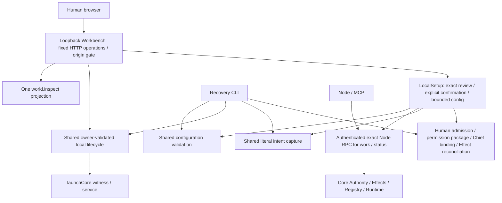

> Final UI completeness: Human control-plane surfaces and the actor-gated capability catalog are closed in R1_UI_COMPLETENESS_REPORT.md. This pass retains one canonical implementation per operation.

> Phase 2 implementation update: ordinary intent entry is now Home/New Work; bounded API provider setup, exact MCP return-route configuration, installed native bridge gate and canonical Human rename are implemented. Node-authorized lifecycle and executable onboarding/verified identity remain advanced. See R1_FINAL_PRODUCT_CLOSURE.md and SETUP_R1.md for current scope. The original inventory below remains the review constraint.

# R1 architecture diet

This correction is in the unpacked R1 release, without Git metadata. `correction-evidence/before` and `before-manifest.json` preserve the source and SHA-256 inventory before modification. No R2 subject-continuity or multi-Session redesign is introduced.

## Final interfaces

The local Human server is a separate ingress, not another Node capability. It intentionally retains origin validation, strict operation schemas, server-held exact review, expiry, configuration fingerprint, policy epoch, secret filtering and mutation serialization. These are semantic/security responsibilities, not pass-through layers.

## Keep: independent invariants

| Abstraction | Independent responsibility |
| --- | --- |
| Node / identity / ModelBinding | Sovereign identity and verified model lineage; never inferred from host name or login |
| Registry / Session | Exact locator, actor, request ID, scoped authority, immutable history and explicit handoff |
| Authority / Human admission | Root authority requires admitted exact Human statement; Node bearer cannot mint Human acts |
| permission-package / package-proof | One manifest-bound Human act; item-scoped, bounded, transactional materialization |
| Effect gate / logical Action / attempts | Final effect boundary, evidence stages, fencing, uncertainty and no replay |
| Runtime / continuations / Supervision | Durable causal work, checkpoint / WAIT, actual Host turn end, accountable review |
| Host adapter / control profile | Actual protocol capability and external effect control; capability is not Authority |
| Frontend registry / HumanBoundary | Exact binding scopes, eligible routes and honest unavailable observations |
| Chief | Human-selected conversation, pinned request provenance and scoped admission / presentation |
| launchCore witness / lifecycle | One live owner, authenticated graceful stop and reconciliation after child exit |
| inspection / UI projection | Authorized canonical read versus presentation labels; no fabricated execution truth |
| local Human ingress / HTTP gate | Local operator authority class, same-origin and explicit browser review |

## Merged or removed in this pass

| Previous conceptual duplication | Correction |
| --- | --- |
| Literal Human goal admission embedded in operator CLI | Extracted `core/local-human-intent.ts`; file CLI and UI call the same canonical capture/admit/revise implementation |
| Structural runtime validation embedded in CLI | Extracted `core/configuration.ts`; CLI preserves its export for existing callers; Setup uses the same function |
| CLI-only owner stop transport | Extracted `core/local-lifecycle.ts`; CLI and Workbench share exact-owner protocol and unknown-stop behavior |
| UI reader default points at old development checkout | Removed hard-coded `D:/CodexProjects/Sidera` fallback; released launcher supplies its own fixed spec path |
| Proposed second frontend read mapping for Setup | Avoided: released static UI and Vite share existing `liveSnapshot` / `projectWorld` |
| Frontend unavailable gate blocks setup page | Setup renders independently of work snapshot success; no mock replacement |
| Runtime config / CLI execution as potential browser bridge | No command runner or generic RPC bridge added; only fixed typed operations |
| Repeated browser secret handling | Added one final recursive server response boundary for setup/work read results, including configured secret substrings and referenced env secrets |

No original module was removed simply to reduce file count. The CLI facade is retained because it provides file input, interactive terminal review and durable recovery receipts. Browser and terminal admission have different trusted-presence evidence, while the admission and authority implementations remain canonical.

## Data movement

| Path | Transformation | Decision |
| --- | --- | --- |
| SQLite → inspection → RPC | Scope filtering and evidence-derived view, then JSON transport | Keep: authorization and canonical read invariant |
| RPC → `projectWorld` → React | One grouping by Responsibility, state-only progress and localized labels; React displays it | Keep one projection; do not add another client mapper |
| Setup status → HTTP redaction → React | Read status + local configured inventory, then browser secret filtering | Keep: configured inventory is labeled separately from observed health |
| profile form → planner → packageActArgs → Human statement → admission → grants | Manifest canonicalization and proof-bound item materialization | Keep: each step establishes a different authority invariant |
| browser goal → shared literal capture → SemanticBasis → cooperation.start | Literal intent/provenance followed by work operation | Keep: Human ownership and Node work are different acts |
| UI stop → local lifecycle → named pipe → owner → child IPC | Human local controller authenticates exact owner; child checks open turn | Keep: owner identity and safe stop are independent responsibilities |

`projectWorld` currently produces localized display objects on the server. Removing that shape would require a coordinated frontend contract migration and would not by itself remove a semantic duplicate, so it is retained for R1.

## Legacy isolation and limits

The legacy native single-route reader remains because existing R1 fixtures explicitly exercise it; it does not enable a browser fallback. RuntimeSpec's explicit `frontend.routes` is the canonical new configuration. Browser automation remains limited to validation/legacy diagnostic modules, never production route selection.

`human-package.ts` contains R0 cooperation constants, `runtime-enroll.ts` and `runtime-return-grant.ts` contain diagnostic-specific command mains, and tunnel/ZCode scripts depend on external installed Hosts. They remain advanced recovery only and are excluded from the normal launcher/Setup chain. Their exported helpers are used by existing behavioral tests; deleting them would remove known recovery semantics, not merely a pass-through.

Remaining product gap: Setup exposes only the inbound-only external MCP Host declaration, not every configured Host adapter or native/MCP return-route credential installation. The Registry's existing retirement/handoff API is Node-authorized and cannot be bypassed by a browser config deletion. These require a concrete Human adapter workflow before being advertised as ordinary GUI operations. This is an R1 release limitation, not an authorization to redesign identity.
