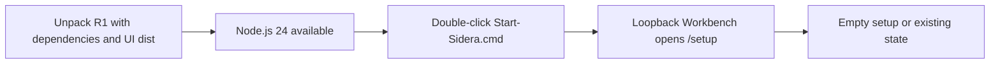
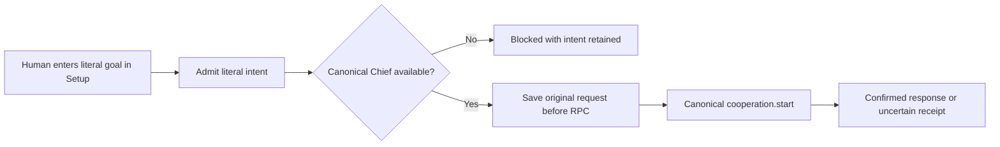
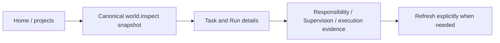
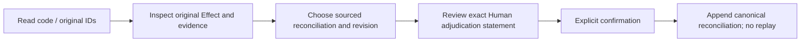
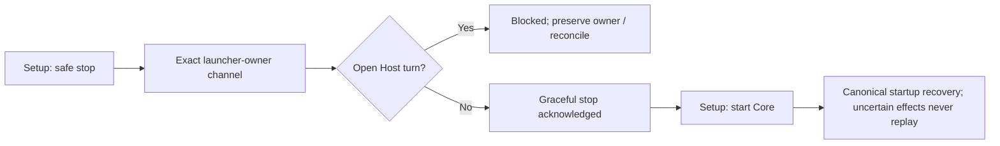

> Final UI completeness: Human control-plane surfaces and the actor-gated capability catalog are closed in R1_UI_COMPLETENESS_REPORT.md. This pass retains one canonical implementation per operation.

> Phase 2 implementation update: ordinary intent entry is now Home/New Work; bounded API provider setup, exact MCP return-route configuration, installed native bridge gate and canonical Human rename are implemented. Node-authorized lifecycle and executable onboarding/verified identity remain advanced. See R1_FINAL_PRODUCT_CLOSURE.md and SETUP_R1.md for current scope. The original inventory below remains the review constraint.

# R1 Human product flows

R1 has one local runtime and independent Nodes. Human owns intent and root Authority. A Node has identity; its Session is an exact Host context. A Chief binding selects an existing Human conversation. A local administration browser is not that conversation and does not establish its Presence or return route. Configured, reachable, authorized, Host accepted, completed, delivered and Human observed remain separate facts.

## 1. Install / first run

The launcher creates only minimal private configuration, SQLite and a local World. It creates no Human, Node, Authority, Chat, login or Presence. Core starts only when a Node configuration exists. An occupied UI port is reported; an existing Core listener is preserved and is not assumed to be this runtime.

## 2. Setup

Permission packages use the existing R1 profile planner and bounded, non-delegable grants. UI simplified profiles contain no filesystem grants and no invented full-access scopes. Explicit full-access mode still covers only the manifest shown. Existing admitted package grants can be provisioned again without manufacturing another Human act.

## 3. Add / connect a Node or Host

The normal UI currently supports safe inbound-only external MCP declarations. It does not pretend they can accept proactive turns. Other executable/API Host configurations, isolated login, verified ModelBinding, existing Session handoff and Node retirement remain advanced operations. These gaps are explicit release limitations, not green readiness.

## 4. Bind Chief

Replacing an existing binding uses `chief.handoff`, with a pinned previous binding and request ID. The local UI never opens a new Chat or substitutes a conversation. Native / protocol return-route adapters are independent requirements; a binding does not install them.

## 5. Submit work

Intent capture grants no Authority. Dispatch still passes Core's current Authority, Effect, exact Session and route gates. No effect retry occurs automatically. Project/task Home remains the work journal; Setup is accessible independently of a failed snapshot.

## 6. Monitor work

One server projection groups Tasks by Responsibility. It cannot infer parallel execution, provider completion or Human observation from Host acceptance. Read timestamps and unavailable state remain visible. Demo is explicitly selected only; failed live reads never load mocks.

## 7. Resolve blocked / error / uncertain

Evidence IDs must reference actual canonical events. Empty evidence, stale revisions and cross-World effects are rejected. Result delivery repair tied to an original executing/receiving Session remains with its authorized Node; the UI cannot impersonate that Session. Missing login, capability or authenticated exact return route is resolved in its owning Host, with the limitation shown locally.

## 8. Stop / restart

The UI remains available after Core stops. Start creates a witnessed Core child through `launchCore`; stop reuses the owner-validated lifecycle operation. There is no process-name kill, generic shell endpoint or forced-stop button. Runtime startup's existing continuation/reconciliation policies are retained; the launcher itself creates or replays no work.
