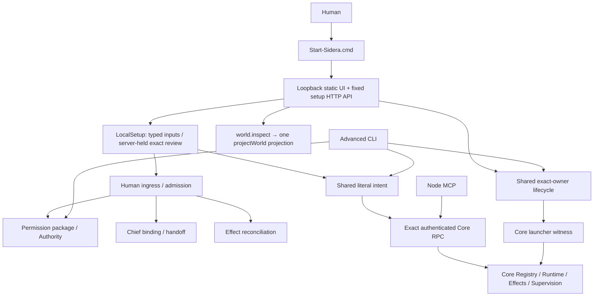

# Phase 2 closure update (2026-10-06)

Final verdict: **HOLD**. The Phase 2 findings below supersede the earlier pass's current-state claims; the original report is retained afterward as historical evidence.

Implemented: typed API Host provider setup; exact binding-scoped MCP HTTP return route with canonical adapter validation; installed native bridge/context gate; canonical Human-reviewed Node rename; LOCAL_READY vs FULL_ROUTE_READY; first-class Home/New Work with literal one-shot intent; removal of dead task controls and two hard-coded diagnostic Node IDs. No R2 changes, generic JSON/shell editor, RuntimeSpec lifecycle rewrite, second projection or admin API stack.

Validated final code: `npm run check` PASS; complete `npm test` **253/253 PASS**, original 249 retained; setup/admin **10/10 PASS**; UI build/typecheck and existing smoke PASS; canonical projection fixture PASS; actual CMD launcher/browser first-run from sanitized candidate PASS. LOCAL_READY reached with FULL_ROUTE_READY false, no Tasks or logical Actions created by blocked work, no secret values returned, typed Human confirmation required. Synthetic browser actions are not physical Human evidence or real external Host E2E.

A sanitized candidate is prepared under the requested release candidate directory with a package payload, ZIP, candidate manifest, privacy scan and SHA256SUMS. Production dependencies are intentionally vendored for offline one-launcher operation; development dependencies, test databases, private runtime, logs, task JSONL, correction checkpoints and local screenshots are excluded. Candidate archive unpack is hash checked and its first run is tested in fresh temp. No GitHub publication and no overwrite of archived v0.1.0 ZIP.

Remaining HOLD reasons: (1) executable Host ordinary installation, isolated login and verified identity enrollment remain advanced; API configuration alone does not close verified ModelBinding; (2) Session bind/handoff, retirement and Host replacement have only Node-authorized canonical operations and cannot be exposed as Human impersonation. SETUP_R1.md lists adapter-specific reasons. Missing external ChatGPT detached return is an explicit external limit, not a local setup failure. Public sanitization is closed by the candidate scan and first-run evidence.

Evidence: `correction-evidence/phase2-final-full-tests.log`, `phase2-setup-tests.log`, `phase2-check.log`, `phase2-final-archive-install.log`; final candidate `CANDIDATE_VALIDATION.json`, `PRIVACY_SCAN.json`, `CANDIDATE_MANIFEST.json`, `SHA256SUMS`. Details: R1_FINAL_PRODUCT_CLOSURE.md and SETUP_R1.md.

Final ZIP SHA-256: `063b94220015213ef337f1970680bc9276ba5241b5e1603c89dd840b5eacc2c9`. Payload: 3,581 files; all unpack checks pass. Root: 3,585 verified hash entries and zero privacy findings. The 95 vendored production dependency entries enable offline launcher operation.

Additional optional `test:live` against an existing runtime was not accepted as live proof: it required a nonempty task journal and found zero visible tasks. The projection-only fixture and isolated first-run validation passed; no task was fabricated to satisfy that diagnostic.

---

# R1 product correction report

## Outcome

**Local Setup/Admin correction implemented and validated. Public-release status: HOLD for remaining ordinary Host / return-route setup gaps.** This is still R1, version 0.1.0. No public publication, installer, R2 continuity redesign, real Host login or external inference was performed.

The local Windows product entry is now **Start-Sidera.cmd → http://127.0.0.1:47320/setup**. The packaged static UI is served by one local Workbench process. It boots a witnessed Core when configured, retains Setup while Core is stopped, and keeps unknown/blocked external capability states visible.

The new UI provides bootstrap/config status, bounded runtime port configuration, config validation, explicit Human principal creation, an inbound-only external MCP Node declaration, exact permission profile review/admission/provision, existing Chief conversation binding/handoff, Core/Gateway/return-route health, safe Core start/stop, literal Human intent/work entry, sourced Effect reconciliation review, and advanced/manual recovery guidance. Existing Home, project, Task, Responsibility and Supervision inspection remain available.

## What was merged / removed

| Change | Reason |
| --- | --- |
| Extracted `core/configuration.ts` from CLI | One config-validation implementation shared by CLI and product UI |
| Extracted `core/local-human-intent.ts` from CLI | One literal Human capture/admit/revise implementation for browser and goal files |
| Extracted `core/local-lifecycle.ts` from CLI | One exact-owner stop protocol for browser and CLI, with unknown-stop/no-kill semantics |
| Removed UI hard-coded old developer checkout fallback | Released reader uses this package's fixed runtime spec, not another workspace |
| Reused existing `liveSnapshot` and `projectWorld` in static server | No additional frontend business projection or mock fallback |
| Setup bypasses failed work-snapshot display gate | First-run administration remains usable without a running Core or granted work view |
| Centralized final browser response redaction | Strip nested secret fields, configured secret substrings, Bearer/sk tokens and referenced environment secrets before React receives results |
| Kept admission and its canonical mutation in one transaction | Failed exact binding or grant application cannot leave a misleading admitted-only success |

No original backend test or business implementation was deleted. The pre-change source checkpoint contains a hash inventory and verified copied files: `correction-evidence/before-manifest.json`, `checkpoint-verification.json`, and `before/`. This unpacked directory has no Git metadata; the original source commit is package provenance, not a claim that these corrected files are still that exact commit. Existing private runtime files were not used as a fresh-install fixture or repackaged.

## Final Human first run

1. Unpack a candidate that contains backend dependencies and `ui/dist`; have Node.js 24 or newer installed.
2. Double-click `Start-Sidera.cmd`. The launcher prints and opens the local Setup address. It creates minimal config/SQLite/World only; it cannot create Human Authority, login, Chat, Presence or effects automatically.
3. Declare the Human principal and a precise external MCP Node edge. Independent Node / Session / Hythe IDs and private random credentials are generated locally. An inbound edge is explicitly not a proactive Agent.
4. Review a complete permission manifest and exact scope. Type the displayed confirmation to admit/apply/provision. Cancelled, wrong, stale and reused confirmations do not grant authority.
5. Review and confirm an existing exact Chief conversation. Replacement uses canonical handoff with the prior binding pinned. Binding alone never establishes a return route.
6. Start Core and inspect actual readiness. Without admitted account identity, actual runtime availability, grants and a real return route, submission remains blocked. The local Setup page is not a substitute Human return route.
7. Enter literal intent in the UI. Save intent or submit once; Core still owns Authority/Effect checks. A blocked route creates no Task or logical Action. Unknown dispatched results retain their original request and are not retried.
8. Open Work Home for canonical monitoring. Stop Core in Setup; the exact owner rejects stopping open Host turns, and Setup remains available for recovery and restart.

The local portions above require no PowerShell after launching the CMD. They do **not** prove a clean package can autonomously deliver results into an arbitrary external Chat: that requires the real supported Host/bridge and its Human account admission.

## Final architecture map

Full decisions and data movement are in `FUNCTION_INTERFACE_MAP.md` and `ARCHITECTURE_DIET_R1.md`. R1 Node identity, exact Session context, Authority, Effect knowledge, Human admission, route pinning, uncertainty and no replay are preserved.

## Validation

| Required check | Result / evidence |
| --- | --- |
| `npm run check` | PASS; `correction-evidence/check.log` |
| `npm test` | **249/249 PASS**, including the unchanged original **243/243**; `final-tests-unsandboxed.log` |
| UI build | PASS typecheck + Vite; `ui-build.log`, delivered `ui/dist` |
| Existing UI smoke | PASS; `ui-smoke.log` |
| Canonical UI projection smoke | PASS; `ui-projection.log`; explicitly local fixture, not live external proof |
| Setup/admin behavior | **6/6 PASS**; `setup-tests.log` |
| Clean-install simulation | PASS fresh OS temp copy without existing `.sidera-dev`; actual CMD launch + real headless Edge; `clean-install-result.json`, `clean-install-smoke.log` |
| No PowerShell after launch | PASS simulated entire browser flow after `Start-Sidera.cmd --no-browser`; the validation harness opens the browser; the ordinary launcher opens it itself |
| No silent Human authority | PASS bootstrap creates no acts/grants; review is inert; wrong/stale/reused confirmation rejected; failed binding rolls admission back; Human setup absent from canonical MCP catalog |
| No browser secret leakage | PASS configured credential values absent from real status responses; nested and free-form secret redaction tests |
| Missing return route remains blocked | PASS canonical status unavailable; literal submission returns `RETURN_ROUTE_UNAVAILABLE`; zero Tasks and zero logical Actions in fresh runtime |
| Safe stop / retained Setup | PASS browser stop completes; local UI remains accessible; original exact-owner stop contract reused |
| Visual browser check | Inspected full-page screenshot after contrast correction; `setup-browser.png` |
| Recovery checkpoint | SHA-256 copied-file verification PASS; `checkpoint-verification.json` |

Initial sandboxed baseline: 243 tests, 241 pass / 2 fail, both `gpt-ui.test.ts` browser initialization tests. Their hard-coded Chrome fixture could not start under that process sandbox. The same browser test file ran outside that sandbox and passed 3/3; the final complete suite then passed 249/249. No original assertions were relaxed or skipped. The final suite adds only `tests/local-setup.test.ts` with six behavioral tests. Browser runs were local synthetic validation, not evidence of a real external model interaction or a physical Human approval.

## Security / authority boundary

The server listens only on 127.0.0.1 and rejects nonmatching Host / Origin / cross-site Fetch Metadata. POST requires JSON, bounded body and strict operation-specific schema. There is no command endpoint, arbitrary file input, arbitrary RPC method input, forced process stop or automatic retry. Private config and credentials never go to React. Review bodies remain server-held, expire after ten minutes, and pin configuration and policy epoch. Human confirmation is recorded explicitly before canonical mutation.

Node credentials do not authenticate local Human operations; no MCP tool registers these endpoints. This is the local operator trust class, comparable to the existing interactive CLI. **Origin and typed confirmation cannot cryptographically distinguish a physical Human from a fully privileged local OS/browser automation actor.** A model with arbitrary local administrator/browser control is already inside that trust boundary; this correction does not claim otherwise. Node-only RPC/MCP callers cannot mint Human admission.

## What remains advanced / CLI-only, and why

| Remaining function | Why not exposed as a generic GUI mutation |
| --- | --- |
| Executable/API Host provisioning beyond external MCP | Needs bounded adapter-specific configuration, isolated credential/login and verified ModelBinding; generic JSON/path/shell input would weaken product and security semantics |
| Native / MCP return-route installation and credential setup | Must use a real official bridge, exact binding scope and Host-owned secret/account; local page/tunnel health cannot invent outbound capability |
| External Host sign-in / account assertion | Human sign-in occurs in the owning Host; existing diagnostic enrollment makes exact Human assertions, not discovered account proof |
| Active Session handoff / replacement | Existing Registry requires exact authorized actor/context and locator validation; editing config cannot replace history or route pending work |
| Node retirement / changing Chief Node identity | Needs a bounded authorized ownership transition, not deletion of a config entry; no R2 redesign or self-authority bypass added |
| Original receiving/executing Session result repair | Canonical reconciliation belongs to the original authorized Session; local Human UI must not impersonate it |
| Arbitrary filesystem permission scopes / package revocation | Existing advanced profile/package tools support exact manifests and explicit Human acts; simplified UI contains no arbitrary file paths or invented full access |
| R0 diagnostic package / one-shot diagnostic enrollment / tunnel/ZCode deployment | Hard-coded diagnostic or installed-Host prerequisites are isolated from the ordinary release flow |

## Release blockers

1. **The fully ordinary fresh-install “setup → ready to execute and return work” path is not yet complete for executable/API Hosts and return-route installation.** Current UI reliably covers local bootstrap/admin and an honest inbound-only edge, but real execution and proactive return require advanced Host/bridge setup. Until bounded adapter setup and credential/account admission are product flows, the broad product-level readiness diagnosis remains open.
2. **Node removal/configuration of active bindings remains advanced.** A proper retirement/Session transition UI must call an authorized canonical operation and preserve open work, history and exact routing; this pass does not replace it with config deletion.
3. **Public package must be rebuilt and sanitized.** This corrected unpacked workspace has pre-existing private `.sidera-dev` state, correction checkpoints/logs and development dependencies. They must not enter a public archive. Original package metadata is retained as provenance; corrected candidate metadata marks HOLD. No public release artifact was created or published.

Known R1 external limits remain: provider completion is not guaranteed, detached Core cannot claim proactive push into the exact external ChatGPT conversation without a real eligible route, and installed external Host/tunnel readiness is not automatically verified. These blockers are explicit; none was turned green to satisfy a test.
